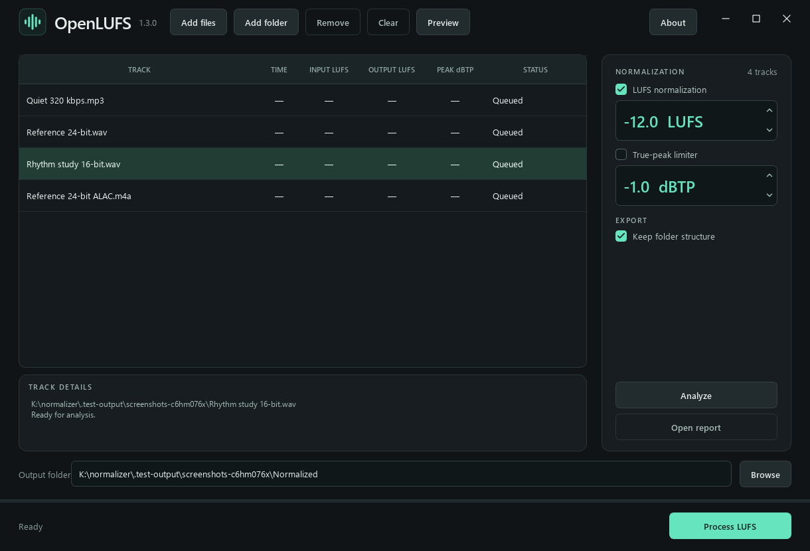
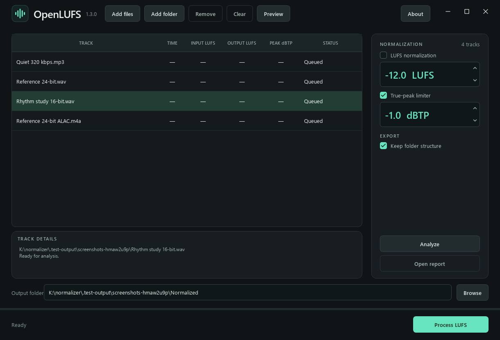

<p align="center"></p>
<h1 align="center">OpenLUFS</h1>
<p align="center"><strong>Audio loudness normalization</strong></p>
<p align="center">LUFS normalization · Optional true-peak limiting · Waveform previews</p>

OpenLUFS adjusts the loudness of audio files while keeping their original formats. It supports constant-gain normalization, optional peak limiting, waveform previews and readable batch reports.

## Download and install

Choose the option for your computer:

| Platform / package | What you get | How to start |
| --- | --- | --- |
| **Windows x64 — installer** | The complete app, an uninstaller, Start menu entries and an optional desktop shortcut | [Download Setup](https://github.com/snuffy420/OpenLUFS/releases/download/v1.3.0/OpenLUFS-1.3.0-windows-x64-setup.exe), open it, and follow the steps below |
| **Windows x64 — portable** | The complete app in a folder; no installation or Python required | [Download Portable](https://github.com/snuffy420/OpenLUFS/releases/download/v1.3.0/OpenLUFS-1.3.0-windows-x64-portable.7z), extract it, then run `OpenLUFS.exe` |
| **Windows — Python source** | The application source and Windows audio tools | [Download Source](https://github.com/snuffy420/OpenLUFS/releases/download/v1.3.0/OpenLUFS-1.3.0-source.7z), then follow [Windows source setup](#windows-source-setup) |
| **macOS — Python source** | Source setup for Intel and Apple silicon Macs, with or without a venv | [Download Source](https://github.com/snuffy420/OpenLUFS/releases/download/v1.3.0/OpenLUFS-1.3.0-source.7z), then follow [macOS setup](#macos-source-setup) |
| **Linux — Python source** | Source setup for supported 64-bit Linux systems, with or without a venv | [Download Source](https://github.com/snuffy420/OpenLUFS/releases/download/v1.3.0/OpenLUFS-1.3.0-source.7z), then follow [Linux setup](#linux-source-setup) |

**Windows 10/11 x64 builds are tested.** macOS and Linux use native Python, Qt and audio tools; their setup paths are provided, but native GUI/audio testing on those operating systems is still pending. There is no packaged Mac app or Linux executable in this release.

### Windows installer

1. Download `OpenLUFS-1.3.0-windows-x64-setup.exe` from [Releases](https://github.com/snuffy420/OpenLUFS/releases).
2. Double-click the downloaded file. Accept the Windows administrator prompt to install under **Program Files**.
3. Follow the setup pages. Leave the installation folder at its default unless you have a reason to change it.
4. Tick **Create a desktop shortcut** if you want one. It is optional.
5. Select **Install**, then **Finish**. Open OpenLUFS from the Start menu or your chosen shortcut.

Python, Qt, FFmpeg and the gain tool are included. No separate audio-tool installation is required. To remove it later, use **Windows Settings → Apps → Installed apps / Apps & features → OpenLUFS → Uninstall**, or the Start menu uninstaller. Installed copies save preferences under `%LOCALAPPDATA%\OpenLUFS`, so the app does not need administrator rights when you use it. Uninstalling keeps your preferences and does not remove your music or exports.

### Windows portable

1. Download `OpenLUFS-1.3.0-windows-x64-portable.7z`.
2. Extract the **entire archive** with a compatible archive extractor, such as [7-Zip](https://www.7-zip.org/).
3. Open the extracted **OpenLUFS** folder and double-click **OpenLUFS.exe**.

Keep the folder somewhere you can write to, such as Documents. Run the extracted executable rather than opening it inside the archive. The portable app remembers settings beside the executable and does not create an Add/Remove Programs entry. Python and the audio tools are included; 7-Zip is only needed to extract the download, not to run OpenLUFS.

### macOS source setup

Use a current 64-bit Intel or Apple silicon Mac. These steps use Python 3.12 and Homebrew.

**1. Install the prerequisites once.** Open **Terminal** from Applications → Utilities. If Homebrew is not installed, follow the instructions at [brew.sh](https://brew.sh/) and its printed **Next steps**, then open a new Terminal window. Run:

```bash
brew install python@3.12 ffmpeg
python3.12 --version
ffmpeg -version
```

Homebrew may ask for your Mac password or Apple's command-line tools. Let it finish; passwords typed into Terminal are not displayed.

**2. Download and open the source folder.** Download the [Source ZIP](https://github.com/snuffy420/OpenLUFS/archive/refs/heads/main.zip), then double-click it in Downloads to extract it. In Terminal, enter:

```bash
cd ~/Downloads/OpenLUFS-main
```

If your folder has another name, type `cd ` with a space after it, drag the extracted folder from Finder into Terminal, and press Return. The folder should contain `norm.py`, `setup.sh` and `run.sh`.

**3. Choose one setup method.** A venv is a private Python environment for this app. It is recommended, and the scripts handle activation for you:

```bash
bash setup.sh
bash run.sh
```

**Without a venv**, use this instead:

```bash
bash setup.sh --no-venv
bash run.sh
```

The no-venv method keeps dependencies in `.python-deps` inside the source folder. It uses your normal Python interpreter without installing packages into macOS's or Homebrew's shared Python environment. Both methods download the checksum-verified native `mp3rgain` helper automatically.

**Next time:** open Terminal, return to the same source folder, and run `bash run.sh`. Setup is only needed again when installing or updating dependencies. Keep the extracted source folder; it contains the app. Preferences are stored in `~/Library/Application Support/OpenLUFS`.

### Linux source setup

These commands target **Ubuntu 24.04 or later** with a desktop session. Other distributions need equivalent Python, FFmpeg and Qt/X11 libraries. Use a supported x64 or ARM64 system with Python wheels available for the supplied dependencies.

**1. Install the prerequisites once.** Open Terminal, usually with **Ctrl+Alt+T**, then run:

```bash
sudo apt update
sudo apt install python3 python3-venv python3-pip ffmpeg libegl1 libxcb-cursor0 libxkbcommon-x11-0 libxcb-xinerama0 fonts-dejavu-core
python3 --version
ffmpeg -version
```

Enter your login password if asked. Terminal does not display password characters. Python must be **3.11 or later**; these scripts prefer Python 3.12 when available and currently select Python 3.11–3.14.

**2. Download and open the source folder.** Download the [Source ZIP](https://github.com/snuffy420/OpenLUFS/archive/refs/heads/main.zip), extract it in Downloads, then run:

```bash
cd ~/Downloads/OpenLUFS-main
```

If the folder name differs, use your file manager's **Open in Terminal** command inside the extracted folder, or type `cd ` and drag the folder into Terminal. Check that it contains `setup.sh` and `norm.py`.

**3. Choose one setup method.** With a venv, recommended:

```bash
bash setup.sh
bash run.sh
```

Without a venv:

```bash
bash setup.sh --no-venv
bash run.sh
```

The no-venv method installs into the source folder's `.python-deps` directory, not the operating system's Python packages. Neither method needs `sudo` for Python dependencies, and neither uses `--break-system-packages`. Both download the verified native gain tool for the detected CPU.

**Next time:** return to the same folder and run `bash run.sh`. Preferences are saved in `~/.config/openlufs`, or under `XDG_CONFIG_HOME` when configured.

### Windows source setup

Install **Python 3.12** from [python.org](https://www.python.org/downloads/windows/), selecting **Add Python to PATH** if offered. Download and extract the source archive, then open Terminal / PowerShell in the extracted folder and run:

```powershell
python -m venv .venv
.\.venv\Scripts\python.exe -m pip install -r requirements.txt
.\.venv\Scripts\python.exe tools/fetch_ffmpeg.py
.\.venv\Scripts\python.exe tools/fetch_mp3rgain.py
.\.venv\Scripts\python.exe norm.py
```

Later, launch **Run OpenLUFS.cmd**, or repeat the last command from this folder. The source release already includes the Windows audio executables; the fetch commands verify/download them for a GitHub checkout.

### Source setup troubleshooting

- **`brew`, `python3.12` or `ffmpeg` not found:** complete the prerequisite installation, follow Homebrew's PATH instructions where applicable, and open a new Terminal window.
- **`setup.sh` / `norm.py` not found:** Terminal is in the wrong folder. Open the extracted OpenLUFS folder in Terminal and try again.
- **`externally-managed-environment`:** use the supplied `bash setup.sh` or `bash setup.sh --no-venv` commands. Both avoid installing into system-managed Python.
- **`No matching distribution found`:** your Python, OS or CPU may not have a compatible wheel. Try Python 3.12 on a current supported operating system; do not force an incompatible package.
- **Linux Qt platform-plugin error:** confirm the listed desktop libraries are installed. This is a desktop application; a headless server needs an appropriate display setup.
- **Missing gain tool:** rerun setup, or run `python3 tools/fetch_mp3rgain.py` from the source folder. The app also checks `mp3rgain` on PATH and supports `OPENLUFS_MP3RGAIN` / `OPENLUFS_FFMPEG` for custom native tool paths.

The CLI uses the same engine. From a configured Mac/Linux source folder, use `bash run.sh normalize --help`; on Windows use `.\.venv\Scripts\python.exe -m openlufs normalize --help`.

## Processing tracks



1. Add files or folders, or drag them into the app.
2. Optionally select **Analyze** to measure the inputs.
3. Choose your target loudness and peak ceiling. Leave the limiter disabled to preserve dynamics, or enable it when matching the target matters more than retaining the original peaks.
4. Select a track and use **Preview** to compare the original with the actual processed result.
5. Choose an output folder and select **Process LUFS**.

OpenLUFS remembers your last-used settings, output folder, preview style and window size. For first use, the settings are −12 LUFS and −1 dBTP, with LUFS normalization enabled and limiting disabled. Originals and existing exports are never overwritten.


### LUFS normalization

OpenLUFS uses ITU-R BS.1770-based integrated LUFS measurement through FFmpeg, with EBU R128 gating. LUFS describes perceived loudness across the whole track. Less negative values are louder: −10 LUFS is louder than −12 LUFS. A target around −12 LUFS is a practical starting point for a DJ library; −14 LUFS generally requires less peak control. There is no universal DJ target.

With the limiter **disabled**, OpenLUFS applies constant gain. This preserves the track's relative dynamics, subject to sample rounding and decoder precision. If reaching the target would exceed the peak ceiling, gain is reduced and the result is marked **Gain capped**. The app shows the achieved LUFS and the difference from the target.

**A quieter result has not matched the requested loudness.** LUFS and dBTP cannot be added together to make two tracks equally loud. To bring a peak-bound track closer to the others, lower the group's target or enable limiting and accept some change in peak dynamics.

Direct MP3/AAC gain moves in approximately 1.505 dB steps; Opus header gain moves in 1/256 dB steps. These steps can also leave a difference from the target without another encode.

### Optional peak limiter

Check **True-peak limiter** to enable it. Both processing checkboxes use the same convention: checked means enabled. With LUFS normalization also enabled, OpenLUFS tries to meet the target within ±0.1 LU while respecting the ceiling. It uses direct gain where that is sufficient and waveform processing where needed.

Limiting reduces peaks independently of the rest of the track. Strong reduction can flatten transients, reduce punch or make the music sound denser. It cannot guarantee unchanged sound. The report identifies limited tracks and estimates the peak reduction so you can review them.


For **peak limiting only**, turn off LUFS normalization and enable the limiter. This controls peaks without boosting the track to a LUFS target. Tracks already below the ceiling are copied unchanged.



### True-peak ceiling

The ceiling is the maximum reconstructed peak, including peaks between digital samples. It is a limit, not a level every track must reach. Start with −1 dBTP; −2 leaves extra margin for later processing, while −0.5 leaves less. Mixing, EQ, effects and later encoding can change peaks again.

## Waveform preview

Select a track, then use **Preview** when its button becomes active. Preview processes a temporary copy using the current LUFS target, peak ceiling and both processing checkboxes. Reopen the preview after changing settings to compare another result. The original and processed waveforms share the same linear amplitude scale, so their level and peak differences remain visible.

**Normal** shows green sample-peak envelopes.


**RGB** combines red bass, green mids and blue highs. Mixed colors show the relative energy of those frequency bands within the full waveform.


**3-band** uses a unified DJ-style waveform per channel: blue bass, orange mids and white highs. Colored layers indicate relative band energy inside the full sample-peak envelope, rather than separate frequency plots.


All three views retain the minimum and maximum decoded sample within each display bin. Synchronized zoom and position controls reveal finer detail; at sample zoom, the actual connected samples replace the envelope. Original and output always use the same amplitude scale. Colors are calculated from band power using 8th-order crossovers, normally 200 Hz and 2500 Hz, adapted for very low sample rates. They are visual frequency indicators, not isolated-band amplitude measurements or a reproduction of a proprietary waveform algorithm.

Preview outputs and decoded waveform/band files are deleted when the panel closes, is cancelled, or fails. Preview does not modify your source or create a batch report. A forced termination or power failure can prevent normal cleanup.

## Formats, encoding and metadata

Supported mono/stereo audio includes **WAV/WAVE, AIFF/AIF/AIFC, FLAC, MP3, raw ADTS AAC-LC, AAC-LC or 16/24-bit ALAC in M4A/M4B/M4R/audio MP4, and Ogg Opus in OPUS/OGG/OGA**. An extension alone does not guarantee a supported encoding. HE-AAC, WMA, Vorbis, protected files, multichannel audio and unsupported variants are rejected.

Exports retain the source extension, supported codec, sample rate and channel count. WAV, AIFF, FLAC and ALAC retain their original supported bit depth; WAV/AIFF also retain supported floating-point encodings. CBR MP3 renders retain their nominal bitrate. VBR renders retain their mode and recoverable quality settings; unknown quality is estimated. AAC/Opus renders target the measured source bitrate. Variable and average bitrates can change after encoding, and the original encoder's full settings cannot always be recovered.

**ALAC (Apple Lossless)** supports 16-bit and 24-bit mono/stereo audio, including normalization, optional limiting and preview. Exports retain the ALAC codec, bit depth, sample rate, channels and supported MP4 metadata, including tags, artwork, private fields and chapters. Its compression is lossless, though processing and sample rounding intentionally change the audio. Compressed bitrate and file size can vary. Other ALAC depths are rejected rather than silently reduced.

When waveform processing is needed, OpenLUFS decodes to a **32-bit floating-point WAV**, then returns to the source format. **Re-encoding MP3, AAC or Opus introduces another lossy generation.** The intermediate preserves processing headroom but does not restore lost detail or make that encode lossless. WAV/AIFF/FLAC/ALAC avoid an additional lossy codec stage; gain, limiting and integer rounding still change their samples intentionally.

User tags, artwork and supported private metadata are retained through format-specific paths. Technical stream information, encoder delay, sample tables and checksums are regenerated where necessary. Existing playback-gain tags are retained rather than recalculated, apart from R128 references adjusted during direct Opus header gain. Players using ReplayGain, R128 or Sound Check can therefore apply additional volume changes. External DJ databases are not modified.

## Reports

**Open report** shows a readable results panel rather than raw report data. It includes input/output LUFS, target differences, true peaks, processing methods, failures and track notes. You can open a previous report and export CSV, readable HTML or JSON report data.


Source analysis is reused while the file remains unchanged. Every export receives a verification pass. Internal rendering retries always read the original float intermediate; they do not repeatedly encode an earlier lossy output. The interface shows a steady **Processing** status during that work.

## Development and license

Developer-only build instructions are in [docs/BUILDING.md](docs/BUILDING.md). Tests cover actual codecs, metadata/depth retention, constant gain, optional limiting, target verification, analysis caching, waveform extrema and frequency bands, preview cleanup, report exports and GUI workflows. Generated test signals do not replace listening tests with your own library.

OpenLUFS is licensed GPL-3.0-or-later. See [LICENSE](LICENSE), [third-party notices](THIRD_PARTY_NOTICES.md) and [publishing notes](docs/PUBLISHING.md).

## Support OpenLUFS


If OpenLUFS is useful to you, consider supporting its development with a Bitcoin donation. Donations are optional and appreciated.

**Bitcoin (BTC):**
`bc1qz8877p6vusc22qrctdj4h7w0uk2l9l9h8lwphy`

You can also scan the QR code in **About → Donate BTC**.

## Contact

Questions, feedback or a bug report? Get in touch through the OpenLUFS contact form.

<p align="center">
  <a href="https://snuffy420.github.io/OpenLUFS/docs/contact.html">
    
  </a>
</p>

