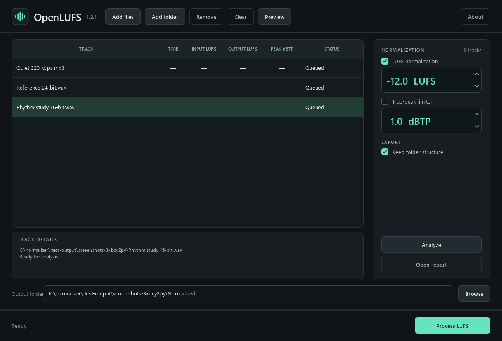
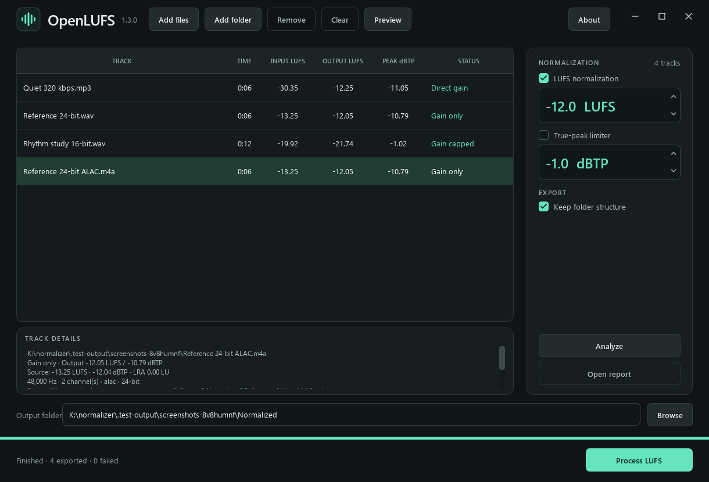
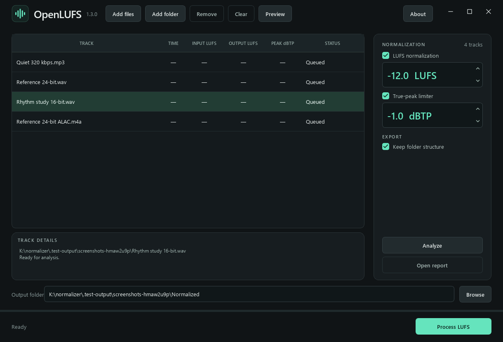
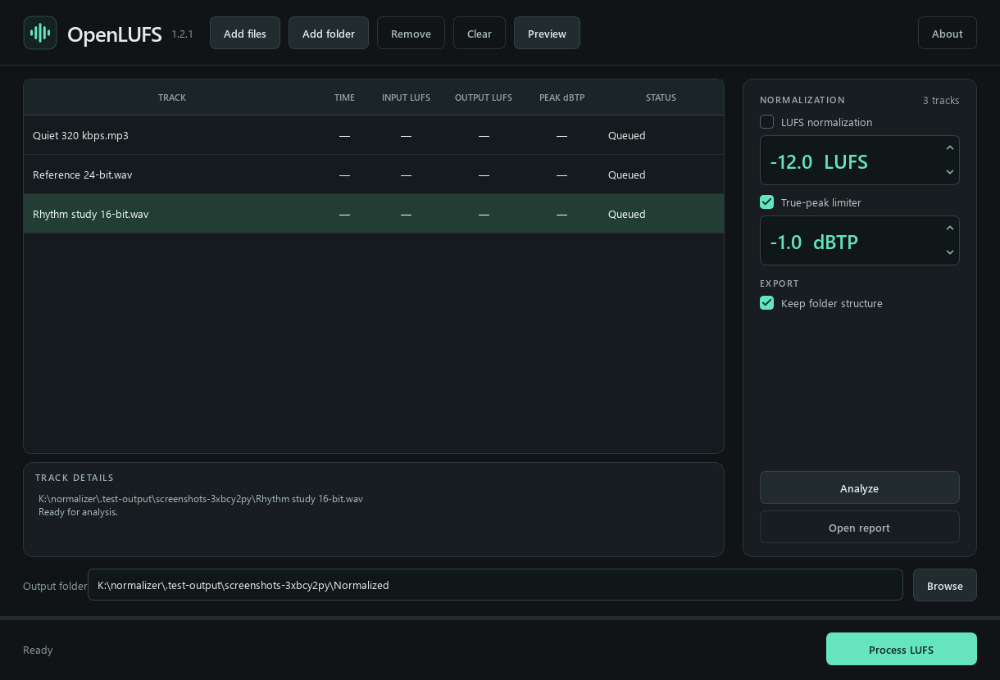
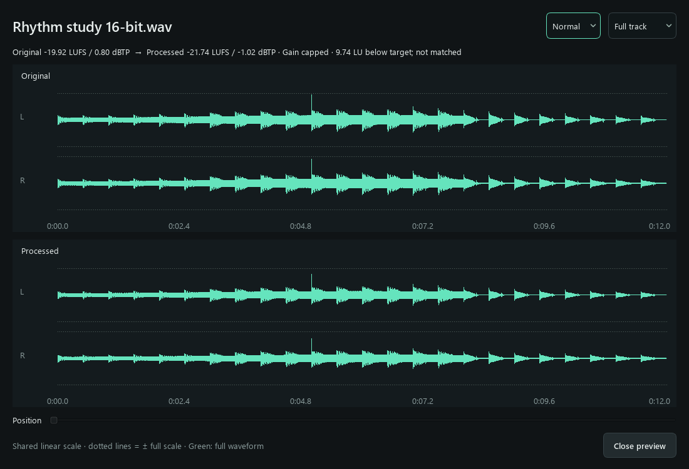
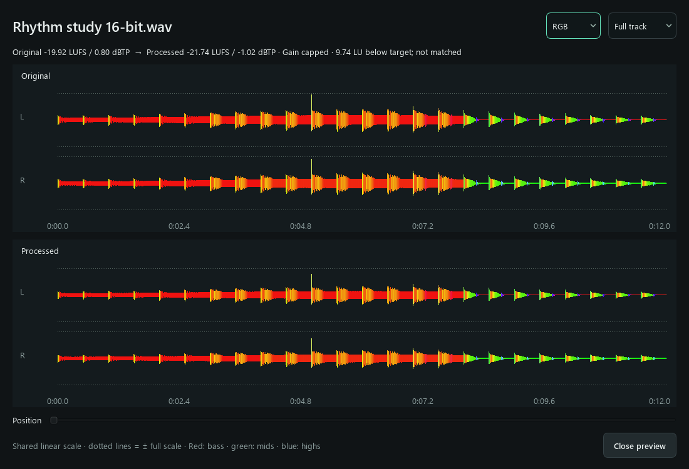
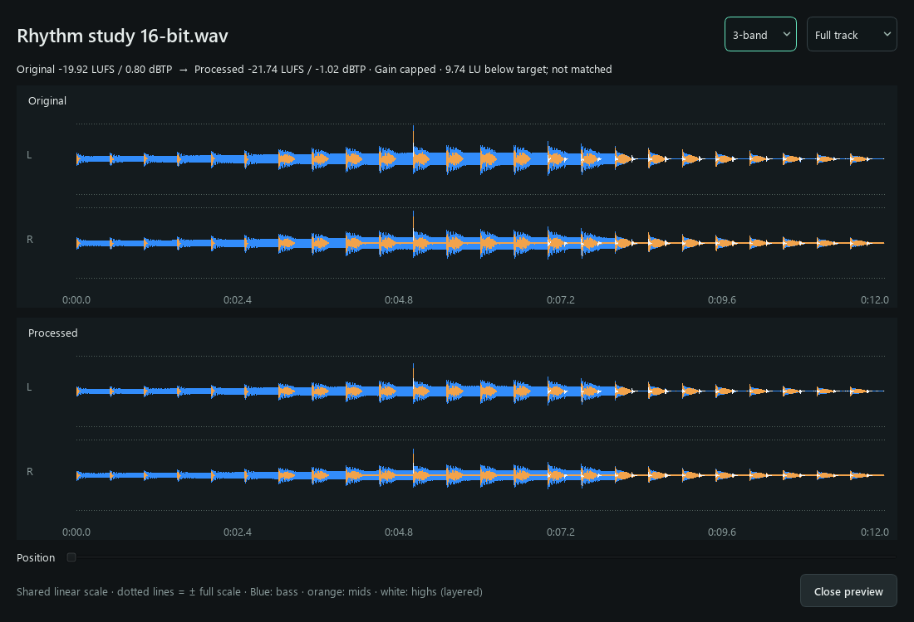
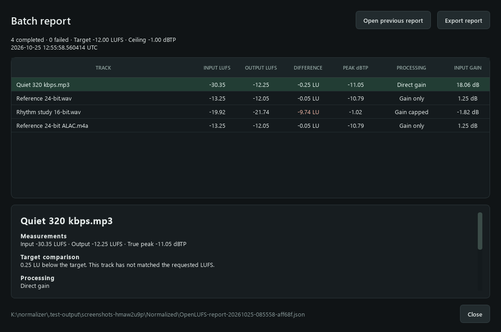

<p align="center"></p>

OpenLUFS adjusts the loudness of audio files while keeping their original formats. It supports constant-gain normalization, optional peak limiting, waveform previews and readable batch reports.

## Download and run

Download the Windows portable package, extract it, and run **OpenLUFS.exe**. Python, Qt and the audio tools are included. The executable runs without installation.

## Processing tracks



1. Add files or folders, or drag them into the app.
2. Optionally select **Analyze** to measure the inputs.
3. Choose your target loudness and peak ceiling. Leave the limiter disabled to preserve dynamics, or enable it when matching the target matters more than retaining the original peaks.
4. Select a track and use **Preview** to compare the original with the actual processed result.
5. Choose an output folder and select **Process LUFS**.

OpenLUFS remembers your last-used settings, output folder, preview style and window size. For first use, the settings are −12 LUFS and −1 dBTP, with LUFS normalization enabled and limiting disabled. Originals and existing exports are never overwritten.



### LUFS normalization

LUFS describes perceived loudness across the whole track. Less negative values are louder: −10 LUFS is louder than −12 LUFS. A target around −12 LUFS is a practical starting point for a DJ library; −14 LUFS generally requires less peak control. There is no universal DJ target.

With the limiter **disabled**, OpenLUFS applies constant gain. This preserves the track's relative dynamics, subject to sample rounding and decoder precision. If reaching the target would exceed the peak ceiling, gain is reduced and the result is marked **Gain capped**. The app shows the achieved LUFS and the difference from the target.

**A quieter result has not matched the requested loudness.** LUFS and dBTP cannot be added together to make two tracks equally loud. To bring a peak-bound track closer to the others, lower the group's target or enable limiting and accept some change in peak dynamics.

Direct MP3/AAC gain moves in approximately 1.505 dB steps; Opus header gain moves in 1/256 dB steps. These steps can also leave a difference from the target without another encode.

### Optional peak limiter

Check **True-peak limiter** to enable it. Both processing checkboxes use the same convention: checked means enabled. With LUFS normalization also enabled, OpenLUFS tries to meet the target within ±0.1 LU while respecting the ceiling. It uses direct gain where that is sufficient and waveform processing where needed.

Limiting reduces peaks independently of the rest of the track. Strong reduction can flatten transients, reduce punch or make the music sound denser. It cannot guarantee unchanged sound. The report identifies limited tracks and estimates the peak reduction so you can review them.



For **peak limiting only**, turn off LUFS normalization and enable the limiter. This controls peaks without boosting the track to a LUFS target. Tracks already below the ceiling are copied unchanged.



### True-peak ceiling

The ceiling is the maximum reconstructed peak, including peaks between digital samples. It is a limit, not a level every track must reach. Start with −1 dBTP; −2 leaves extra margin for later processing, while −0.5 leaves less. Mixing, EQ, effects and later encoding can change peaks again.

## Waveform preview

Select a track, then use **Preview** when its button becomes active. Preview processes a temporary copy using the current LUFS target, peak ceiling and both processing checkboxes. Reopen the preview after changing settings to compare another result. The original and processed waveforms share the same linear amplitude scale, so their level and peak differences remain visible.

**Normal** shows green sample-peak envelopes.



**RGB** combines red bass, green mids and blue highs. Mixed colors show the relative energy of those frequency bands within the full waveform.



**3-band** uses a unified DJ-style waveform per channel: blue bass, orange mids and white highs. Colored layers indicate relative band energy inside the full sample-peak envelope, rather than separate frequency plots.



All three views retain the minimum and maximum decoded sample within each display bin. Synchronized zoom and position controls reveal finer detail; at sample zoom, the actual connected samples replace the envelope. Original and output always use the same amplitude scale. Colors are calculated from band power using 8th-order crossovers, normally 200 Hz and 2500 Hz, adapted for very low sample rates. They are visual frequency indicators, not isolated-band amplitude measurements or a reproduction of a proprietary waveform algorithm.

Preview outputs and decoded waveform/band files are deleted when the panel closes, is cancelled, or fails. Preview does not modify your source or create a batch report. A forced termination or power failure can prevent normal cleanup.

## Formats, encoding and metadata

Supported mono/stereo audio includes **WAV/WAVE, AIFF/AIF/AIFC, FLAC, MP3, raw ADTS AAC-LC, AAC-LC in M4A/M4B/M4R/audio MP4, and Ogg Opus in OPUS/OGG/OGA**. An extension alone does not guarantee a supported encoding. HE-AAC, ALAC, WMA, Vorbis, protected files, multichannel audio and unsupported variants are rejected.

Exports retain the source extension, supported codec, sample rate and channel count. WAV, AIFF and FLAC retain their original storage depth or floating-point format. CBR MP3 renders retain their nominal bitrate. VBR renders retain their mode and recoverable quality settings; unknown quality is estimated. AAC/Opus renders target the measured source bitrate. Variable and average bitrates can change after encoding, and the original encoder's full settings cannot always be recovered.

When waveform processing is needed, OpenLUFS decodes to a **32-bit floating-point WAV**, then returns to the source format. **Re-encoding MP3, AAC or Opus introduces another lossy generation.** The intermediate preserves processing headroom but does not restore lost detail or make that encode lossless. WAV/AIFF/FLAC avoid an additional lossy codec stage; gain, limiting and integer rounding still change their samples intentionally.

User tags, artwork and supported private metadata are retained through format-specific paths. Technical stream information, encoder delay, sample tables and checksums are regenerated where necessary. Existing playback-gain tags are retained rather than recalculated, apart from R128 references adjusted during direct Opus header gain. Players using ReplayGain, R128 or Sound Check can therefore apply additional volume changes. External DJ databases are not modified.

## Reports

**Open report** shows a readable results panel rather than raw report data. It includes input/output LUFS, target differences, true peaks, processing methods, failures and track notes. You can open a previous report and export CSV, readable HTML or JSON report data.



Source analysis is reused while the file remains unchanged. Every export receives a verification pass. Internal rendering retries always read the original float intermediate; they do not repeatedly encode an earlier lossy output. The interface shows a steady **Processing** status during that work.

## Python source

Extract the source package and use Python 3.11 or later:

```powershell
python -m venv .venv
.\.venv\Scripts\python.exe -m pip install -r requirements.txt
.\.venv\Scripts\python.exe norm.py
```

On Windows, you can also run `setup.ps1`, then `Run OpenLUFS.cmd`. The source package includes native Windows audio tools. GitHub checkouts fetch them using the scripts documented in [Building from source](docs/BUILDING.md). Non-Windows source operation requires compatible native dependencies and has not been validated.

The CLI offers the same processing engine. See `python -m openlufs normalize --help` for LUFS and limiter options.

## Development and license

Developer-only build instructions are in [docs/BUILDING.md](docs/BUILDING.md). Tests cover actual codecs, metadata/depth retention, constant gain, optional limiting, target verification, analysis caching, waveform extrema and frequency bands, preview cleanup, report exports and GUI workflows. Generated test signals do not replace listening tests with your own library.

OpenLUFS is licensed GPL-3.0-or-later. See [LICENSE](LICENSE), [third-party notices](THIRD_PARTY_NOTICES.md) and [publishing notes](docs/PUBLISHING.md).
