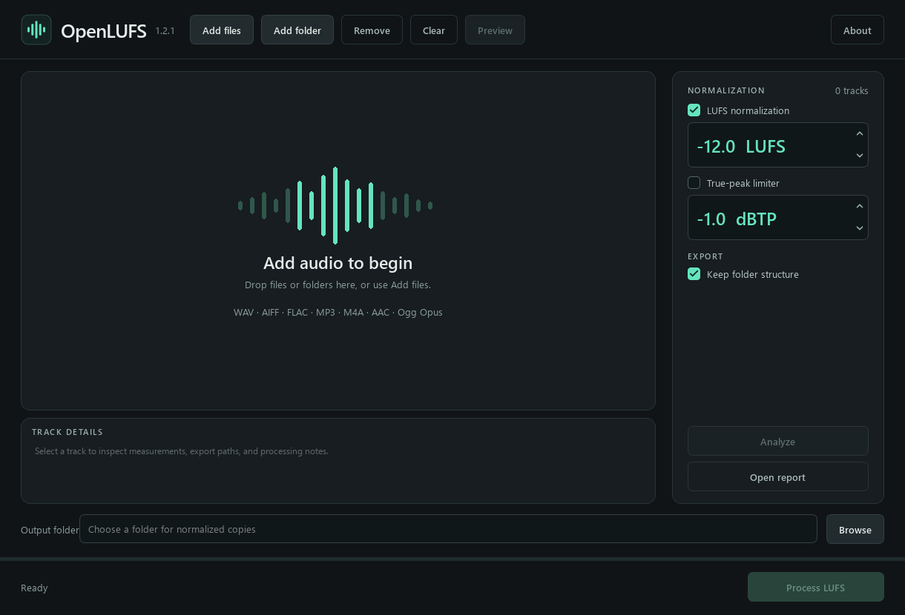

<p align="center"></p>

OpenLUFS measures integrated loudness and writes normalized copies using constant gain. It keeps the original file format and avoids another lossy encoding generation. It never uses compression or a peak limiter to force a louder result.

**320 kb/s MP3 in → 320 kb/s MP3 out. 24-bit WAV in → 24-bit WAV out.**

## Screenshots




These screenshots show the current interface using generated test audio processed by the actual engine. Additional screenshots can be placed in `docs/screenshots/`.

<!-- Add screenshots here:  -->

## Processing behavior

- **MP3:** adjusts encoded gain directly without re-encoding the audio. Decoding is used for measurement only. CBR bitrate, VBR mode, frame sizes and original tags remain intact.
- **AAC-LC in M4A/M4B/M4R/MP4 or raw ADTS AAC:** uses direct encoded gain without another AAC encode. M4A's non-audio atoms are checked for changes.
- **Ogg Opus:** changes the standard output-gain header in 1/256 dB steps. Encoded audio packets are checked byte-for-byte. Descriptive tags and artwork are retained; existing R128 track/album references are adjusted as required by the format.
- **PCM WAV / AIFF:** changes only the original sample payload, retaining its storage depth, sample rate, channels and original container metadata bytes.
- **FLAC:** applies gain to decoded PCM and compresses it losslessly again at the original bit depth, rate and channel count. Non-technical metadata blocks are preserved verbatim; STREAMINFO is updated for the new audio; old seek indexes are replaced or omitted when no valid replacement is available.

The intended operation is volume adjustment across a whole track, with the same gain applied throughout. There is no tempo stretching, pitch alteration, EQ, dynamic compression or peak limiting.

## Original format and resolution

Exports follow each input automatically:

| Source | Export |
| --- | --- |
| 320 kb/s CBR MP3 | 320 kb/s CBR MP3 |
| 128 kb/s CBR MP3 | 128 kb/s CBR MP3 |
| VBR MP3 | Same VBR encoding and bitrate mode |
| 16-bit WAV | 16-bit WAV |
| 24-bit WAV | 24-bit WAV |
| 16-bit FLAC | 16-bit FLAC |
| 24-bit FLAC | 24-bit FLAC |
| 16-bit AIFF | 16-bit AIFF |
| 24-bit AIFF | 24-bit AIFF |
| Supported AAC-LC / M4A | Same container and encoded AAC stream, with direct gain adjustment |
| Ogg Opus | Same encoded audio packets, with output-header gain adjustment |

Sample rate and channel count remain unchanged. Supported 32-bit PCM and floating-point variants also retain their native storage format. Lossless FLAC recompression can change compressed file size and bitrate; its PCM resolution is retained.

The intended volume change changes audio data. “Match the source” describes the retained format, encoding properties and original metadata; processed files are not promised to be byte-identical to the originals. Original files remain untouched.

## Loudness targets and peak headroom

The desktop starts at **−12 LUFS** and **−1 dBTP** for a fresh configuration. Both fields are directly editable. Target loudness accepts −36 to −6 LUFS; the true-peak ceiling accepts −9 to −0.1 dBTP. Saved preferences take precedence; the CLI defaults to −14 LUFS.

LUFS describes the measured loudness across a whole track; less negative values are louder. For a DJ library, −12 LUFS is a practical starting point, with −10 to −12 LUFS available if you prefer a louder target. −14 LUFS provides a quieter baseline. These are starting values, not a universal DJ standard.

True peak estimates the waveform between digital samples. The ceiling is its maximum permitted level after processing. **−1 dBTP** leaves headroom below full scale; **−2 dBTP** provides extra margin for later encoding or processing. **−0.5 dBTP** leaves less margin. A ceiling is a limit, not a peak level every track must reach, and cannot guarantee the level after later EQ, effects or encoding.

A track can only be made louder with unchanged dynamics until its peaks reach the ceiling. When there is insufficient headroom, OpenLUFS applies less gain and reports **Gain capped** with the actual achieved loudness. It does not clip or limit the peaks to manufacture the requested LUFS reading.

Direct MP3/AAC gain is available in **1.50515 dB steps**. OpenLUFS uses the nearest peak-safe step. Without a peak constraint, rounding alone can leave approximately **±0.75 LU** of target error, plus meter resolution. Peak constraints can leave a larger shortfall. WAV, AIFF and FLAC use continuous fixed gain and are checked against a 0.1 LU target tolerance when headroom allows. Opus header gain uses finer **1/256 dB steps**. Every final export is measured again.

Matching integrated LUFS provides a measured baseline; it does not guarantee identical subjective loudness across every genre or recording. BS.1770 is a measurement standard, not a prescription for one ideal target.

## What “as losslessly as possible” means

MP3 and AAC were already lossy when encoded originally. Their direct-gain path adds no new compression generation and does not restore information previously discarded. A supported 320 kb/s MP3 remains 320 kb/s, rather than becoming a larger WAV or a newly encoded MP3.

WAV/AIFF samples change intentionally when gain is applied. Keeping an integer bit depth requires rounding to that depth, so processed samples are not bit-identical to the original and absolute mathematical losslessness is not claimed. FLAC compression itself remains lossless for the resulting PCM. The relative dynamics are retained subject to this finite precision and the decoder's numerical behavior.

## Supported files

This release processes mono and stereo:

| Input | Output |
| --- | --- |
| MPEG Layer III MP3, CBR or VBR | Same MP3 encoding, direct gain only |
| AAC-LC in M4A, M4B, M4R or audio MP4 | Same container/AAC encoding, direct gain only |
| Raw ADTS AAC-LC | Same AAC format, direct gain only |
| Supported PCM / float WAV or WAVE | Same WAV sample format and storage depth |
| Supported PCM / float AIFF, AIF or AIFC | Same AIFF sample format and storage depth |
| FLAC, supported PCM depth | Same FLAC depth, rate and channels |
| Opus in OPUS, OGG or OGA | Same Ogg Opus packets, output-header gain only |

HE-AAC, ALAC, WMA, DRM-protected audio, multichannel files and unsupported container variants are rejected when a verified preserving path is unavailable. Ogg is a container: **Opus is supported; Vorbis is not**. File extensions alone do not guarantee a supported codec. Chained or multiplexed Ogg streams are rejected. There is no silent fallback to WAV and no lossy re-encoding fallback. Silence and audio below the loudness gate cannot be normalized.

## Metadata

OpenLUFS preserves original metadata, including private tags and cue-related container data, rather than copying only a list of familiar fields:

- WAV/AIFF: the original container is cloned and only its audio sample region is replaced. Unknown chunks, ID3 data, artwork and other original bytes outside the samples remain in place.
- FLAC: original comments, artwork, cue and application blocks are retained. Technical stream information and the seek index must describe the newly encoded frames.
- MP3/AAC: the source file is cloned and the direct-gain tool is instructed not to write analysis or undo tags. Leading/trailing MP3 tags and M4A non-audio atoms are checked for changes.
- Opus: descriptive comments, private tags, vendor information and artwork are retained. Existing `R128_TRACK_GAIN` and `R128_ALBUM_GAIN` values are adjusted by the opposite header-gain change, as required by [RFC 7845](https://www.rfc-editor.org/rfc/rfc7845.html#section-5.2). Encoded audio packets remain unchanged.

Outside the Opus R128 technical-reference exception above, existing ReplayGain, R128 gain and other playback-gain metadata is **retained unchanged**. Players that use those tags can therefore apply an additional gain adjustment; the per-track report flags recognized playback-gain tags. External DJ databases and analysis files are outside the exported audio file and are not modified. Originals and existing exports are kept intact; filenames are made unique when necessary.

## Portable Windows version

1. Download `OpenLUFS-1.2.0-windows-x64-portable.7z` and its `.sha256` checksum from **Releases**.
2. Extract the archive to a writable folder with a 7z-compatible archive manager.
3. Launch **OpenLUFS.exe**.

Python, Qt, FFmpeg, the direct-gain tool and other runtime dependencies are bundled. No separate Python or FFmpeg installation is required. Windows 10/11 x64 is the intended platform. The executable is unsigned and unpacks its runtime into a temporary directory while running. Preferences are stored beside it in `OpenLUFS.settings.json`.

## Basic workflow

1. Use **Add files**, **Add folder**, or drag audio into the library.
2. Select **Analyze** to inspect input loudness, if desired.
3. Choose a target loudness and a true-peak ceiling.
4. Choose an output folder, then select **Normalize copies**.
5. Read the achieved LUFS and peak values. **Gain capped** means peak headroom prevented reaching the target with unchanged dynamics.

The track count and **Analyze** button are in the right panel. Selecting a track fills the compact **Track details** panel beneath the list. The window is resizable, with scrolling available when the available space is too small. **About** contains a full settings guide and an explanation of each supported format.

Use **Open report** for the JSON report containing input/output measurements, applied gain and notes. The output format follows each source automatically; there is no conversion selector or peak-limiter option.

## Run from source

Download `OpenLUFS-1.2.0-source.7z` and its checksum, then extract the complete folder. Use Python 3.11 or later. The Windows source release includes `vendor/ffmpeg.exe` and `vendor/mp3rgain.exe`.

```powershell
python -m venv .venv
.\.venv\Scripts\python.exe -m pip install -r requirements.txt
.\.venv\Scripts\python.exe norm.py
```

Alternatively, run `setup.ps1`, then `Run OpenLUFS.cmd`.

Distribution consists of the Python source and the portable Windows executable. No packaged macOS app is provided. Running the source on another operating system requires compatible Python/PyQt6 and native FFmpeg/mp3rgain tools; the supplied `.exe` dependencies are Windows-only. Non-Windows source operation has not been validated.

Git checkouts exclude the executable dependencies. Fetch their pinned, verified versions after installing the build dependencies:

```powershell
python -m pip install -r requirements-build.txt
python tools\fetch_ffmpeg.py
python tools\fetch_mp3rgain.py
```

The source CLI uses the same original-format workflow:

```powershell
python -m openlufs analyze "D:\Music\track.mp3"
python -m openlufs normalize "D:\Music" -o "D:\Normalized" --target -14 --ceiling -1
```

CLI analysis prints JSON. Non-finite measurements are represented as `null`. Normalization writes a JSON report in the output folder. Use the Python CLI for terminal workflows; the desktop executable has no console window.

## Project structure

```text
openlufs/
  models.py       Settings, measurements, discovery and filename planning
  engine.py       BS.1770-based metering and verified constant gain
  containers.py   Original metadata and container preservation
  ogg.py          Opus header gain and encoded-packet verification
  batch.py        Batch orchestration and JSON reports
  gui.py          Qt interface and worker threads
  theme.py        Interface styling
  help.py         About guide and format explanations
  cli.py          Command-line entry point
  diagnostics.py  Compiled-executable checks
assets/           Original icon, vector artwork and banner
vendor/           Pinned processing tools and provenance manifests
licenses/         Third-party license texts
tests/            Real audio and GUI integration tests
tools/            Dependency fetch, build, screenshots and bundle checks
```

See [engineering notes](docs/ENGINEERING.md) and [GitHub publishing instructions](docs/PUBLISHING.md).

## Build and validation

```powershell
python -m pip install -r requirements-build.txt
python tools\fetch_ffmpeg.py
python tools\fetch_mp3rgain.py
python tools\build.py
```

The Windows build also requires 7-Zip (`7z.exe` on PATH or installed in `C:\Program Files\7-Zip`). The build runs tests, compiles `dist/OpenLUFS.exe`, and exercises the frozen application's PCM, MP3 and Opus backends plus Qt/icon initialization. It produces portable and source `.7z` archives in `releases/`, with individual SHA-256 checksum files (`.sha256` and `.sha`) and a combined `SHA256SUMS.txt`. No Mac app is packaged.

To verify a download in PowerShell:

```powershell
Get-FileHash .\OpenLUFS-1.2.0-windows-x64-portable.7z -Algorithm SHA256
```

Compare the hash with the accompanying checksum file. The `.sha` files contain SHA-256 hashes, identical to their `.sha256` counterparts.

Tests check shared supported-file lists, typed loudness/ceiling settings, resized controls, Opus header gain/audio-packet identity/R128 references, container aliases, real 320/128 kb/s MP3 and VBR exports, constant-gain waveform residuals, 24-bit WAV/AIFF/FLAC preservation, metadata blocks and atoms, peak-safe gain, source protection, cancellation, scans and GUI behavior. Repeatable signals establish engineering behavior; they do not replace listening tests with a broad music library or testing on additional Windows machines.

The current source suite contains **37 tests**, including format integration and GUI workflows. Layout checks also run at 100%, 150% and 200% display scaling.

## License and acknowledgments

OpenLUFS is licensed **GPL-3.0-or-later**. Dependencies retain their own licenses; see [LICENSE](LICENSE), [THIRD_PARTY_NOTICES.md](THIRD_PARTY_NOTICES.md), and `licenses/`.

The workflow was inspired by [waveAlign](https://wavealign.app/). OpenLUFS is independent, uses original branding and graphics, and makes no claim to use waveAlign's proprietary algorithm. Direct MP3/AAC adjustment uses [mp3rgain](https://github.com/M-Igashi/mp3rgain).
